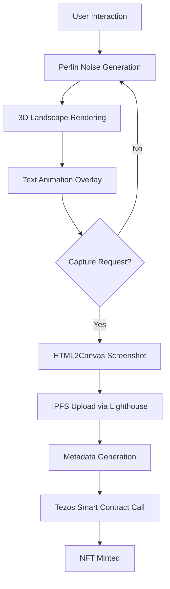

# Ruido Perla NFT Collection - Complete Project Documentation

## Table of Contents

1. [Project Overview](#project-overview)
2. [Artistic Vision](#artistic-vision)
3. [Technical Architecture](#technical-architecture)
4. [Features & Functionality](#features--functionality)
5. [Setup & Installation](#setup--installation)
6. [Configuration](#configuration)
7. [Component Reference](#component-reference)
8. [Smart Contracts](#smart-contracts)
9. [Deployment](#deployment)
10. [API Reference](#api-reference)
11. [Troubleshooting](#troubleshooting)
12. [Contributing](#contributing)

---

## Project Overview

**Ruido Perla** (Pearl in Noise) is an innovative digital art NFT project that transforms the concept of collectible art through real-time generative simulations. Born from an immersive audiovisual installation by artist Luis Negrón van Grieken, this project bridges physical art installations with blockchain technology, creating an evolving digital ecosystem on the Tezos blockchain.

### Key Characteristics

- **Interactive Art**: Real-time generative landscapes using Perlin noise algorithms
- **Poetic Integration**: Animated text overlays from philosophical poetry
- **NFT Innovation**: Dynamic minting system with tier-based pricing
- **Eco-Conscious**: Built on Tezos for environmental sustainability
- **Access-Gated**: NFT ownership unlocks exclusive features

---

## Artistic Vision

### Conceptual Foundation

The project explores the philosophy of finding beauty ("pearl") within chaos ("noise"). It investigates how meaningful moments emerge from seemingly random systems, questioning the boundaries between order and disorder, memory and simulation.

### From Installation to Digital

1. **Physical Origin**: Kinetic audiovisual installation in Berlin featuring synchronized sound objects and generative simulations
2. **Digital Evolution**: Translation of installation's core simulation into an interactive web experience
3. **NFT Gateway**: Each token serves as both collectible art and access key to the living system

### Poetic Elements

The project integrates multilingual poetry exploring themes of:
- **Emigration and displacement**
- **Contemplation and mysticism** 
- **The beauty of coincidence**
- **Navigation through uncertainty**

---

## Technical Architecture

### Frontend Stack

```
┌─────────────────────────────────────────┐
│                Gatsby App               │
├─────────────────────────────────────────┤
│              React Components           │
├─────────────────────────────────────────┤
│     Three.js    │  Perlin Noise  │ UI   │
│     Rendering   │  Generation    │ Ctrl │
├─────────────────────────────────────────┤
│   Tezos         │    IPFS        │ Web3 │
│   Blockchain    │    Storage     │ Libs │
└─────────────────────────────────────────┘
```

### Core Technologies

- **Framework**: Gatsby 5.14+ (React-based static site generator)
- **3D Graphics**: Three.js with WebGL rendering
- **Blockchain**: Tezos with Beacon wallet integration
- **Storage**: IPFS via Lighthouse SDK
- **Styling**: Bootstrap + Styled Components
- **Animation**: Framer Motion

### System Flow



---

## Features & Functionality

### 1. Interactive Simulation

**Real-time Perlin Noise Visualization**
- Adjustable parameters: amplitude, scale, frequency, octaves
- Multiple noise algorithms (Perlin, Simplex)
- Camera controls with orbit functionality
- Auto-animation modes

**Text Animation System**
- Rotating poetic fragments
- Smooth opacity transitions
- Responsive typography
- Multi-language support

### 2. NFT Minting System

**Dynamic Capture & Mint**
- Real-time screenshot capture of 3D simulation
- Metadata includes current Perlin parameters
- Tier-based pricing system (1/3/10 TEZ)
- Supply-limited collection

**Access Control**
- Wallet connection required for minting
- NFT ownership verification for premium features
- Admin privileges for contract owner

### 3. Collection Browser

**NFT Gallery**
- Swiper-based responsive carousel
- Direct Objkt marketplace integration
- Attribute filtering and display
- Mobile-optimized interface

### 4. Video & Media Integration

**Multimedia Content**
- Video player integration for installation documentation
- Image galleries showcasing physical installation
- Responsive media handling

---

## Setup & Installation

### Prerequisites

- Node.js 18+ and npm
- Git
- Modern browser with WebGL support

### Step 1: Clone Repository

```bash
git clone https://github.com/your-username/ruidoperlanft.git
cd ruidoperlanft
```

### Step 2: Install Dependencies

```bash
npm install
```

### Step 3: Environment Configuration

Create `.env.development` and `.env.production` files:

```env
# Required - Lighthouse IPFS API Key
GATSBY_LIGHTHOUSE_API_KEY=your_lighthouse_api_key_here

# Tezos Configuration
GATSBY_NETWORK_TYPE=ghostnet
GATSBY_TEZOS_CONTRACT_ADDRESS=KT1BjvQ6LQD16FLzb9Snz9TSVbdGUDXkfjq5
GATSBY_TEZOS_REALTIME_CONTRACT=KT1ThB25BSC32NSNsEenSW8c5cPN3A7J2CG2
GATSBY_ADMIN_WALLET=tz1...
GATSBY_CREATOR_WALLET=tz1...

# API Endpoints
GATSBY_TZKT_API=https://api.ghostnet.tzkt.io

# Development Flags
GATSBY_DEVELOPMENT=true
DEVELOPMENT=true
```

### Step 4: Run Development Server

```bash
# Standard development
gatsby develop

# High memory allocation for large builds
sudo NODE_OPTIONS="--max-old-space-size=8192" DEVELOPMENT=true GATSBY_DEVELOPMENT=true gatsby develop
```

### Step 5: Access Application

- Local development: `http://localhost:8000`
- GraphQL explorer: `http://localhost:8000/___graphql`

---

## Configuration

### Environment Variables Reference

| Variable | Purpose | Required | Default |
|----------|---------|----------|---------|
| `GATSBY_LIGHTHOUSE_API_KEY` | IPFS storage authentication | ✅ | - |
| `GATSBY_NETWORK_TYPE` | Tezos network (mainnet/ghostnet) | ✅ | ghostnet |
| `GATSBY_TEZOS_CONTRACT_ADDRESS` | Main collection contract | ✅ | - |
| `GATSBY_TEZOS_REALTIME_CONTRACT` | Real-time minting contract | ✅ | - |
| `GATSBY_ADMIN_WALLET` | Admin wallet address | ✅ | - |
| `GATSBY_CREATOR_WALLET` | Artist wallet address | ✅ | - |
| `GATSBY_TZKT_API` | TzKT API endpoint | ❌ | https://api.ghostnet.tzkt.io |

### Perlin Noise Parameters

Default simulation parameters can be configured:

```javascript
const defaultParams = {
  amplitude: 12.5,    // Displacement intensity
  scale: 0.008,       // Noise frequency scaling
  frequency: 1,       // Base frequency multiplier
  octaves: 1,         // Noise layers
  usePerlin: true     // Perlin vs Simplex noise
}
```

---

## Component Reference

### Core Components

#### `PerlinNoise.js`
Primary simulation component handling 3D rendering and user interaction.

**Props:**
- `initialParams`: Default noise parameters
- `enableOrbit`: Enable camera controls
- `cameraParams`: Initial camera position
- `controlsVisible`: Show/hide control panel
- `verificationEnabled`: Enable NFT ownership checks

#### `WalletContext.js` & `WalletConnection.js`
Manages Tezos wallet connectivity and state.

**Context Values:**
- `walletAddress`: Connected wallet address
- `isConnected`: Connection status
- `connectWallet()`: Initiate connection
- `disconnectWallet()`: Clear connection

#### `MintNFTProcess.js`
Handles NFT minting workflow with tier-based pricing.

**Features:**
- Screenshot capture and processing
- IPFS upload via Lighthouse
- Metadata generation
- Smart contract interaction
- Tier pricing calculation

#### `TezosNFTCarousel.js`
Displays collection NFTs in responsive carousel.

**Features:**
- TzKT API integration
- Objkt marketplace links
- Attribute display
- Mobile optimization
- Caching system

### Utility Components

#### `PerlinControls.js`
Interactive control panel for simulation parameters.

#### `NFTVerification.js`
Checks NFT ownership for access-gated features.

#### `Html2CanvasUploader.js`
Generic component for capturing and uploading screenshots.

---

## Smart Contracts

### Contract Addresses

**Ghostnet (Development)**
- Collection Contract: `KT1BjvQ6LQD16FLzb9Snz9TSVbdGUDXkfjq5`
- Real-time Contract: `KT1ThB25BSC32NSNsEenSW8c5cPN3A7J2CG2`

**Mainnet (Production)**
- [To be deployed]

### Minting Parameters

```javascript
// Tier-based pricing structure
const getTierPrice = (supply) => {
  if (supply < 100) return 1;      // 1 TEZ
  if (supply < 500) return 3;      // 3 TEZ
  return 10;                       // 10 TEZ
}

// Royalty distribution
const royalties = {
  decimals: 4,
  shares: {
    [minterAddress]: 500,    // 5%
    [creatorAddress]: 500    // 5%
  }
}
```

### Contract Integration

```javascript
import { TezosToolkit } from '@taquito/taquito';
import { BeaconWallet } from '@taquito/beacon-wallet';

// Initialize Tezos toolkit
const tezos = new TezosToolkit('https://ghostnet.ecadinfra.com');
const wallet = new BeaconWallet(walletOptions);

// Mint NFT
const contract = await tezos.contract.at(contractAddress);
const operation = await contract.methods.mint(
  mintParams.to,
  mintParams.amount, 
  mintParams.metadata,
  mintParams.royalties
).send();
```

---

## Deployment

### Production Build

```bash
# Clean previous builds
gatsby clean

# Build for production
gatsby build

# Serve locally for testing
gatsby serve
```

### Netlify Deployment

The project is configured for automatic Netlify deployment:

1. **Repository Connection**: Connected to GitHub repository
2. **Build Settings**:
   - Build command: `gatsby build`
   - Publish directory: `public/`
3. **Environment Variables**: Configure in Netlify dashboard
4. **Domain**: https://ruidoperlanft.netlify.app

### Manual Deployment Steps

1. Build production version
2. Upload `public/` directory contents
3. Configure environment variables
4. Set up domain and SSL
5. Configure redirects if needed

### Environment-Specific Configurations

**Development**
- Uses Ghostnet for testing
- Local IPFS node optional
- Debug logging enabled

**Production**
- Mainnet Tezos contracts
- Production IPFS endpoints
- Error tracking integration
- Performance monitoring

---

## API Reference

### TzKT API Integration

Used for fetching NFT collection data:

```javascript
// Get collection tokens
const response = await fetch(`${tzktApi}/v1/tokens/balances?contract=${contractAddress}&limit=1000`);

// Get token metadata
const tokenData = await fetch(`${tzktApi}/v1/tokens?contract=${contractAddress}&tokenId=${tokenId}`);
```

### Lighthouse IPFS API

For decentralized storage:

```javascript
import lighthouse from '@lighthouse-web3/sdk';

// Upload file
const response = await lighthouse.upload([file], apiKey, signed);

// Get upload status
const status = await lighthouse.getUploads(publicKey);
```

### GraphQL Queries

For static content management:

```graphql
query {
  allMarkdownRemark {
    nodes {
      fileAbsolutePath
      rawMarkdownBody
      frontmatter {
        title
      }
    }
  }
}
```

---

## Troubleshooting

### Common Issues

**Build Errors**

```bash
# Memory allocation issues
sudo NODE_OPTIONS="--max-old-space-size=8192" gatsby develop

# Clear Gatsby cache
gatsby clean
```

**Wallet Connection Issues**
- Ensure wallet extension is installed and unlocked
- Check network matches configuration (ghostnet/mainnet)
- Clear browser cache and restart

**IPFS Upload Failures**
- Verify Lighthouse API key is valid
- Check file size limits
- Ensure stable internet connection

**Three.js Rendering Issues**
- Verify WebGL support in browser
- Check for hardware acceleration
- Update graphics drivers

### Debug Mode

Enable detailed logging:

```javascript
// In gatsby-browser.js
if (process.env.GATSBY_DEVELOPMENT === 'true') {
  console.log('Development mode enabled');
}
```

### Performance Optimization

```javascript
// Optimize Three.js rendering
renderer.setPixelRatio(Math.min(window.devicePixelRatio, 2));
renderer.shadowMap.enabled = false; // Disable shadows for performance

// Reduce geometry complexity on mobile
const segments = isMobile ? 10 : 17;
```

---

## Contributing

### Development Workflow

1. **Fork Repository**
2. **Create Feature Branch**: `git checkout -b feature/new-feature`
3. **Make Changes**: Follow coding standards
4. **Test Thoroughly**: Ensure all functionality works
5. **Submit PR**: Include detailed description

### Code Standards

- **JavaScript**: ES6+ with modern React patterns
- **CSS**: Styled Components with CSS-in-JS
- **Components**: Functional components with hooks
- **State Management**: Context API for global state

### Testing Guidelines

- Test wallet connection flows
- Verify NFT minting process
- Check responsive design
- Validate performance on mobile devices

### Documentation

- Update relevant documentation for new features
- Include code comments for complex logic
- Provide usage examples

---

## License & Credits

### License
This project is licensed under 0BSD License - see LICENSE file for details.

### Credits
- **Artist**: Luis Negrón van Grieken
- **Development**: [Contributors]
- **Blockchain**: Tezos Foundation
- **Storage**: Lighthouse Protocol

### Acknowledgments
- Berlin art community for installation support
- Tezos ecosystem for sustainable blockchain infrastructure
- Open source community for foundational libraries

---

## Contact & Support

- **Website**: https://ruidoperlanft.netlify.app
- **Artist**: Luis Negrón van Grieken
- **Issues**: GitHub Issues section
- **Community**: [Discord/Telegram links]

---

*Last Updated: December 2024*